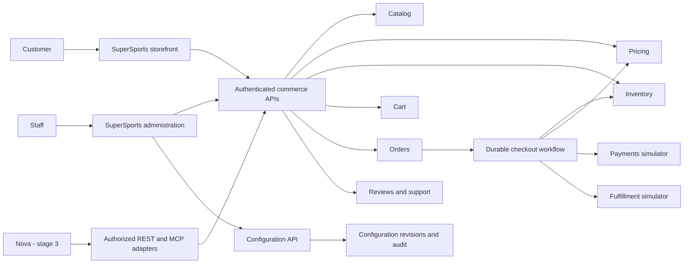
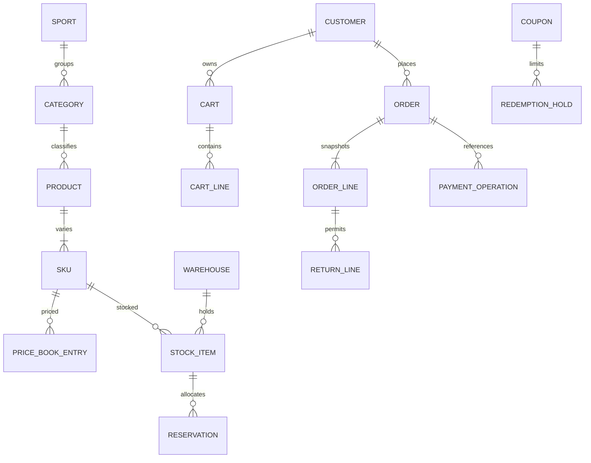
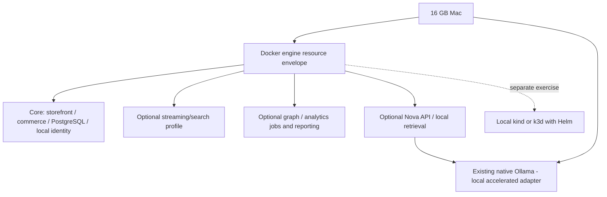

# SuperSports baseline architecture
Revision 2 · 2026-10-23 · Proposed design; no deployed services.

## Constraints and choices
User-directed: local-only, 16 GB Mac, Docker, monorepo, independent projects, devops infrastructure, INR/Indian defaults, Cricket/Football, local Ollama, three-stage progression.
Provisional technical choices: Java/Spring Boot for commerce; Python/FastAPI for Nova and data; TypeScript/React/Next.js for the web application; PostgreSQL, Redis, Kafka/Debezium, OpenSearch, Neo4j, object storage/Iceberg/Spark/Trino/Superset; Temporal candidate.
These are technology families, not verified version pins. S1-M02 must verify current stable compatible versions using primary sources and exercise minimal images before accepting them.

## Context and ownership


| Project under services/ | Owns | Does not own |
|---|---|---|
| catalog | Sports/category hierarchy, product/SKU attributes, asset metadata | Prices or stock |
| pricing | Currency price books, coupon definitions/redemption holds, quote calculation, simulated tax/shipping rules | Captures or orders |
| inventory | Warehouses, stock movements, reservations, inspection/restock decisions | Product descriptions |
| cart | User cart and wishlist; SKU references, quantities, chosen currency | Authoritative prices/stock |
| orders | Immutable accepted quote snapshot, order lifecycle, checkout idempotency, Saga coordinator worker project initially colocated here | Other service tables |
| payments | Simulated authorization/capture/void/refund ledger | Order status |
| fulfillment | Shipment simulation and tracking transitions | Inventory allocation authority |
| engagement | Reviews, moderation, support tickets, notification simulation as explicit internal modules | Purchase eligibility authority |
| configuration | Non-secret settings revisions, validation, activation state, adapter references, audit | Raw credentials or arbitrary executable configuration |
| nova (stage 3) | Agent state, tool routing, retrieval/context/memory policies | Commerce transactions or private tables |

Each is independently buildable/deployable with its own migrations/tests. One local PostgreSQL server may host separate service databases/users. No shared domain ORM or shared table reads. Identity is a local provider dependency under devops, not a custom authentication service. Frontend lives under apps/storefront with customer/admin route groups; authorization lives server-side.
Data pipelines own derived graph/analytics projections in data/pipelines. Shared contracts contain schemas, never shared business entities.

## Core entities and relations

Cross-service relationships are IDs and public contracts, not cross-database foreign keys. Order lines snapshot names/SKU attributes, currency, prices, discount allocations, simulated tax, shipping, policy revisions and totals. Persist money in integer minor units with a currency precision registry; never binary floating point. Stock movements/reservations and payment operations have unique business-operation keys.

## Business invariants and simulation policy
- Product attributes are schema-driven by category; SKU defines purchasable variant. No hardcoded sport enum.
- Available stock = on-hand minus active reservations; allocation is atomic. Ship decrements on-hand and consumes reservations exactly once. Failed allocation or expired reservation cannot produce a confirmed order.
- Quote includes currency, selected items, address, coupon, tax/shipping rules, price revisions and expiry. Checkout revalidates authoritative values.
- Price books are explicit per currency. Changing the default currency requires complete valid active-SKU prices; carts require an explicit new quote if currency changes. Historical orders/refunds retain original currency. Exchange conversion is deferred.
- Simulation default proposal: tax-exclusive catalog prices; configurable synthetic tax rate (initially 0 until configured); shipping flat rate per currency (initially 0), no legal tax claims. Discount applies before tax; shipping is not coupon-eligible initially. Allocate order discounts proportionally to eligible line subtotals, round once in minor units using largest remainder with SKU/order-line ID as deterministic tie-breaker.
- One coupon per order initially. Eligibility supports explicit SKU/category inclusion, time interval, currency-specific threshold/maximum discount, global/per-customer limits. Reserve redemption capacity atomically with an expiry; commit upon order confirmation, release on failure. Duplicate business keys cannot consume limits twice.
- Payments never collect real card details. Authorize → capture before order confirmation in the first simulator policy. On failure before capture: void; after capture: refund. Failed compensation enters manual-resolution state. Fulfillment scheduling follows confirmation; scheduling failure retries visibly without claiming the order shipped.
- Reservation/quote/authorization expiry and ordering are explicit workflow deadlines, tested with a controllable clock. Expired reservations trigger compensation rather than resurrecting stock.
- Cancellation before shipment releases reservations or restores unshipped allocation and refunds captured amounts as appropriate. Returns after delivery operate by order-line quantity. Refund amount uses the original allocated discount/tax; cumulative refunds cannot exceed capture. Restock requires inspection and is independent of refund approval.
- Only delivered purchases can be reviewed; one active review per purchased SKU/customer initially, with edit history and moderation.

## Checkout and compensation
```mermaid
sequenceDiagram
  participant C as Customer
  participant O as Orders and Saga
  participant P as Pricing
  participant I as Inventory
  participant M as Payments simulator
  participant F as Fulfillment simulator
  C->>O: Checkout approved quote + idempotency key
  O->>P: Revalidate quote and hold coupon capacity
  P-->>O: Validated snapshot or conflict
  O->>I: Reserve SKUs atomically
  I-->>O: Reservation IDs or unavailable
  O->>M: Authorize then capture (operation IDs)
  alt Captured while quote/reservations valid
    O->>P: Commit redemption
    O->>O: Confirm immutable order
    O->>F: Schedule shipment idempotently
    O-->>C: Confirmed / fulfillment pending
  else Unknown payment outcome
    O->>O: Persist pending reconciliation; retain operation IDs
    O->>M: Query authoritative authorization/capture status
    M-->>O: Known result or still pending
    O->>O: Continue confirmation or compensation only after reconciliation
  else Confirmed decline or expired allocation with known payment outcome
    O->>M: Void authorization or refund capture
    O->>I: Release active reservations
    O->>P: Release redemption hold
    O->>O: Failed or manual resolution
    O-->>C: Explicit recoverable outcome
  end
```
If a response is lost, query the operation outcome before retrying; persisted Saga state and operation keys prevent duplicate effects. Confirmation cannot rely on a coupon hold that expired: validate/commit before confirm and compensate a captured payment if commit fails. Each participant has authoritative atomic state transitions. A pending payment result remains pending, never guessed as failure. Fulfillment must verify confirmed order and valid allocation before dispatch.

## Events, CQRS and analytics
Commands use REST/OpenAPI; errors carry stable code, field details, retryability and correlation ID. Same idempotency key plus changed request returns conflict; retention window and uniqueness scope must be documented per command.
Transactions write service state plus outbox atomically. Debezium publishes versioned Kafka events containing event ID, type/version, aggregate ID/version, occurred time and correlation/causation IDs. Partition by aggregate for ordering; dedupe by event ID and reconcile versions.
OpenSearch and graph are derived; live checkout facts come from owners. Kafka introduces at-least-once delivery, not global exactly-once semantics. S1-M04 can use a rebuildable catalog snapshot/index worker until S1-M06 installs CDC; public contracts remain stable.
Raw events land in local object storage, Spark builds Iceberg facts/dimensions, Trino/Superset serve reports. Select an Iceberg catalog during S1-M08. ClickHouse is optional only with a measured workload.

## Configuration administration
Categories: store/localization; pricing/promotions/tax/shipping simulations; asset storage; cache/search; messaging/workflows; identity/access; telemetry; Nova/models.
Settings are typed and allowlisted, with category, scope, validation, sensitivity classification, activation mode and revision. Read permitted settings → propose revision → validate → preview impact → explicitly activate → audit → report applied/pending/failed.
Runtime changes affect new quotes only. Restart-required settings are recorded as pending; UI never launches shell commands. Deployment adapter selection produces validated desired configuration for devops to apply. Database/storage changes require migration, backup/restore and compatibility verification, not a dropdown hot swap. Secrets use mounted secret references; only reference names and redacted status appear in UI/logs.
No arbitrary endpoint URL input: adapters use an operator-managed endpoint allowlist; reject unsupported schemes and unapproved targets, disable redirects, authenticate server-side and redact errors. Testing adapters must not become an SSRF/proxy endpoint.
Roles: platform-admin config activation; catalog-admin merchandising; inventory-operator stock; support scoped investigations; customer own resources. Role changes take effect server-side immediately; no browser-only enforcement.

## Nova boundary
Stage 2 defines requirements after commerce works. Stage 3 starts with grounded read-only discovery/comparison, then cart actions and explicit approval-bound purchase/return operations.
All models stay local. Start by evaluating a small quantized Ollama model on the actual Mac; select model/license/tool-call support using measured tasks. Embeddings and optional rerankers must also run locally.
MCP is an adapter, not an authorization layer. Tool authorization derives from the authenticated actor; untrusted product/review/policy text cannot change permissions. Never insert Nova into stock or payment transaction control.

## Local deployment and resource hypothesis

Proposed envelopes, not benchmark results: reserve at least 4 GB for macOS/tools; target core container RSS below 6 GB using small JVM heaps; run inference or heavy data jobs selectively in the remaining space. Do not allocate independent 6 GB limits to each profile and claim their sum fits. First bootstrap must measure RSS, pressure, startup time and architecture support; reduce active workloads/heap/process counts before accepting the envelope.
Core starts selected services needed for the current lesson, rather than all ten JVMs from day one. Full commerce integration must be demonstrated on the Mac without Nova/data workloads. If it cannot fit, resolve the architecture before declaring the local requirement met. Larger-machine profile may combine workloads; it is still local/self-hosted.
Kubernetes is an alternate deployment target, not an additional always-on cluster beside Compose. Host-installed Ollama is the only inference runtime; do not create or run an Ollama container. Native Ollama endpoint is restricted to the Docker host bridge/private local boundary; document firewall and bind configuration. A containerized Ollama option is superseded by the user's host-only instruction.
Terraform manages documented local/self-hosted resources where meaningful; Helm owns workload deployment. Never add a cloud provider just to demonstrate Terraform.

## Repository layout
- services/<service>/ — independently buildable commerce and Nova projects, tests, migrations, project context.
- apps/storefront/ — TypeScript browser project with customer/admin pages.
- contracts/ — OpenAPI, event and tool schemas.
- data/pipelines/ — independently runnable ingestion/transformation projects and fixtures; no infrastructure definitions.
- devops/ — all Dockerfiles/build contexts, Compose, Kubernetes/Helm, Terraform, local CI scripts, observability and operations.
- docs/ — decisions, milestone/review evidence, teaching, traceability, context.
- design/ and architecture/ — current design package and preserved editable baseline diagrams.
No deployment manifests or operational scripts in service directories; devops Dockerfiles use each project directory as an explicit build input. Hosting-provider-required CI entry points, if later requested, may only delegate to devops.

## Risks and deferred decisions
16 GB resource feasibility is unmeasured. Exact versions, local identity provider, Temporal versus simpler durable orchestration, Kubernetes distribution, object-store product and model choices are S1-M02/S2 selection tasks. Adding all dependencies immediately violates the profile strategy. No production resilience, legal tax compliance or capacity claim is established by this design.
