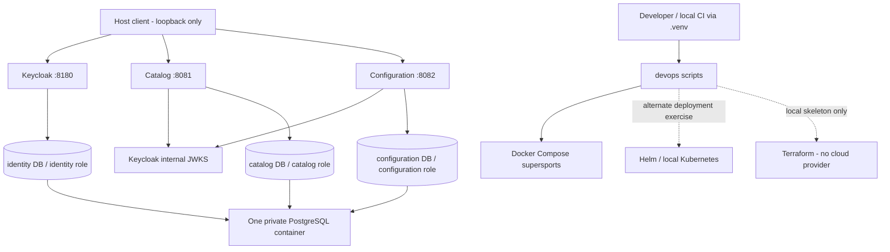

# S1-M02 — Repository and local platform bootstrap
Revision 1 · 2026-10-23 · Design before implementation.
Origin: requirements/accepted-requirements.md and docs/milestones/S1-M01/README.md.
Scope: R10–R13, R16/R17/R19; initial AE12/AE13 foundation, not full business/UI acceptance.

## Outcome and limits
A clean checkout can initialize local secrets, independently build/test two Java service projects, start a private Docker core profile, authenticate against local Keycloak, read a migrated configuration database, and run health/auth/isolation/recovery regressions.
No product CRUD, storefront, pricing engine, checkout or Nova is implemented here. Those retain their milestone owners. Configuration edits/activation UI are S1-M04 work. Bootstrap adds a read-only typed settings registry plus migration-owned initial revision.
All app/dependency containers are ARM64-native with bounded memory. Existing host-installed Ollama is the explicit inference exception; no Ollama container will be created or run. Java builds/tests run in containers; Python operational scripts run only through the repository .venv. Setup downloads are allowed; no cloud runtime dependency.

## Chosen baseline and sources
- Spring Boot 4.1.2: latest stable official reference, Java 17–27 compatibility. https://docs.spring.io/spring-boot/system-requirements.html
- Java 27: current stable feature release compatible with Boot; containerized Temurin. Do not claim LTS. Pin runtime digest and record actual runtime patch from java -version.
- Maven 3.10.0: current stable download; Maven 4 RC is excluded. https://maven.apache.org/download.cgi
- PostgreSQL 18.6: current stable; PostgreSQL 19 RC is excluded. https://www.postgresql.org/
- Keycloak 26.8.1: current server distribution. https://www.keycloak.org/downloads
- Existing host Python 3.14.7 / pip 26.2.1 / Docker 29.8.0 / Compose 5.5.1 are observed tool versions; not unverified cross-machine requirements.
Docker registry manifests verified 2026-10-23:
  build: maven:3.10.0-eclipse-temurin-27@sha256:095c056353550ea93605f9cbd200a7cbbc489a1989eeec8b8600749a157a0096
  runtime: eclipse-temurin:27-jre@sha256:d6bfa738df69e8dec9061b3e26f2ae564d92ad169faa36086dcfa33f0a901d35
  database: postgres:18.6-alpine@sha256:898c60cb390d1085bc97bdd6a1ae968757421df394b071848b52b1c09c89d6a5
  identity: quay.io/keycloak/keycloak:26.8.1@sha256:79c623a22abacf3fe6c00a5fb30f5b7843d717b234033b80995891c06116d244
License families: Spring Boot/Maven/Keycloak Apache-2.0; Temurin OpenJDK GPLv2 with Classpath Exception; PostgreSQL PostgreSQL License. Dependencies/images carry additional transitive/component licenses; capture notices/SBOM as release tooling expands. HashiCorp Terraform uses BSL-1.1; this is infrastructure tooling, not a model. Future models must satisfy the user's open-source/local requirement.
Local identity import/health references: https://www.keycloak.org/server/importExport and https://www.keycloak.org/observability/health.

## Deployment and trust boundaries

Compose project/network/volume names are scoped to this repository's project. No fixed container names. No host PostgreSQL port. Publish API and Keycloak ports only on 127.0.0.1.
Initial limits: PostgreSQL 384 MiB, Keycloak 768 MiB, Catalog/Configuration 512 MiB each. JVM heaps max 192 MiB for application services and 384 MiB for identity, with measured RSS/health checks before acceptance. Builds run serially if concurrent compilers cause memory pressure. Kubernetes is an alternate target, not an always-on duplicate stack.

## Service and API contract
Independent Maven projects: services/catalog and services/configuration. No shared parent aggregator or shared persistence model; both can build from their own pom.xml. Small duplicated bootstrap/security configuration is intentional until a proven common library is warranted.
Both expose:
- GET /actuator/health/liveness: unauthenticated, process health.
- GET /actuator/health/readiness: unauthenticated, includes database health, no sensitive detail.
- Other actuator endpoints are not exposed.
Catalog: GET /api/v1/catalog/status returns {service:"catalog",status:"ready",schemaVersion:1}; requires customer or catalog-admin role and a valid API audience.
Configuration: GET /api/v1/configuration returns {revision:1,categories:[...],settings:[...]}; requires platform-admin role.
Categories are store-localization, commerce-simulations, storage, search-cache, messaging-workflows, identity-access, observability, nova-models. Settings are allowlisted migration-defined records with key, category, value (string representation), valueType, activationMode and revision. Initial values: INR, IN, en, supported currencies INR/USD, simulated payment/shipping/tax, local storage, local identity, local-only Nova endpoint kind. Bootstrap valueType is STRING, STRING_LIST (JSON array represented as text), or BOOLEAN; activationMode is MIGRATION_ONLY so metadata does not imply a dynamic activation capability. No URL/credential editing or dynamic write endpoint yet. Metadata must not imply supported runtime actions which do not exist.
Unsupported HTTP methods/routes do not mutate settings. Error/auth responses must not contain secrets.

## Authentication
Realm supersports, realm roles customer/catalog-admin/platform-admin. Token issuer is exactly http://localhost:8180/realms/supersports for the default host profile. Services fetch keys through http://identity:8080/realms/supersports/protocol/openid-connect/certs; issuer and API audience supersports-api remain mandatory.
Local CLI client supersports-cli uses direct access grants only for synthetic dev fixtures; no real user passwords. A separate client without the API audience exists only for negative authorization tests. Future browser client uses authorization code/PKCE, not password grants.
Demo passwords, database passwords and Keycloak bootstrap-admin password are randomly generated into devops/.local/bootstrap.env with mode 0600 in a 0700 directory. Never print them in command output, logs or docs. Realm import references environment placeholders; no committed password values.
Owner DB roles are non-superusers with no cross-database CONNECT grant; PUBLIC access is revoked from owned databases. Applications receive only their own credentials. Schema migrations run via the owning service role in its own database. Postgres bootstrap superuser stays infrastructure-only.

## Build, operations and migration contract
All Dockerfiles, Compose, identity import, database initialization, test orchestration, Helm, Terraform and tooling scripts live under devops.
One multi-stage Java Dockerfile accepts the explicit service project path, runs Maven verify, copies its executable jar into a non-root runtime. Builds fail on test failure. Host builds expose reports in the owning project's target directory through a separately documented container test command.
Operations launcher calls .venv/bin/python, never system Python. Standard-library Python orchestration avoids a tool-only dependency tree.
Commands: doctor, configure, validate, build, up, down, status, unit, test, reset, release, rollback. Command meanings/flags are documented with the implementation.
Configure is idempotent and never silently rotates existing passwords. Reset removes only this project's volumes, needs an explicit --confirm-reset project-name flag, and preserves generated credentials. down preserves data.
Flyway migrations are versioned and checksum-validated. Bootstrap schema version 1 is additive. A rollback restores known application image IDs against the same compatible schema; it never runs destructive down-migrations. Incompatible schema rollback must refuse or require a documented restore path later.
Initial deterministic fixtures are migration-owned configuration values and realm synthetic users. Repeated starts must not duplicate/reset them; business fixture generators belong to S1-M03.
Local CI entry point: structural/contract/secret checks, unit tests in Maven containers, Compose start, integration/regression checks. No hosted CI account assumed. A local release records verified image IDs; rollback uses only that recorded artifact set.
Bootstrap dependency scanning should run an explicit local scanner if available/selected; do not claim a security scan occurred merely because a build passed. Image SBOM/scan gates are expanded before S1 release.

## Implementation units
### U1 — Independently buildable service foundations
Files: services/catalog/** and services/configuration/** only.
Implement service apps, Flyway schema/fixtures, typed read APIs, JWT issuer/audience/role enforcement, DB-aware readiness, unit tests and project context.
Evidence strategy: new unit tests before production implementation; preserve observed red result where practical. Auth/isolation evidence comes from real-stack regressions, not mocks.
Tests: realm-role conversion with missing/malformed claims; Catalog status shape; Configuration category/setting read model ordering and explicit value/activation types; database unavailable readiness; anonymous 401, wrong-role 403, valid-role 200, tampered/wrong-audience tokens 401.
Unit dependencies: reviewed design committed.

### U2 — Docker and operational foundation
Files: devops/docker/**, devops/compose/**, devops/postgres/**, devops/identity/**, devops/scripts/**, devops/tests/**, devops/images.lock.json, root .dockerignore; host owns these.
Implement core Compose, initialization, identity realm, per-project script launcher, local CI/unit/integration/regression/recovery/release commands.
Tests: configure idempotence/modes/no logging; explicit reset guard; project name validation; allowlisted commands; Compose validation and immutable image pins; live DB isolation; migrations/restart persistence; loopback bindings; authenticated APIs; DB outage/recovery; image rollback smoke; no secrets in tracked files.
Unit dependencies: reviewed shared service/API contract, not service source. Verify live stack only after U1 integration.

### U3 — Alternate deployment and teaching artifacts
Files: devops/helm/**, devops/terraform/**, devops/kubernetes/**, docs/lessons/S1-M02.md only.
Implement Helm chart/values for the same two apps plus private PostgreSQL/identity dependencies, local kind configuration, Terraform local/self-hosted skeleton with no cloud provider, and teaching walkthrough. Secret material supplied externally; no passwords in default values or rendered fixtures.
Verify Helm lint/template, schema/values, Terraform fmt/validate; do not claim cluster deployment unless actually run. Native tools may be downloaded into ignored devops/.local/bin; application/dependency workloads stay Dockerized.
Unit dependencies: reviewed deployment/API contract. No shared changes with U1/U2.

## Verification and exit gate
Record exact commands, versions, image IDs, test counts/outcomes, core RSS and limits on this Mac. Tests must exercise real running dependencies for persistence/JWT/isolation.
Critical cases: clean generated environment start; idempotent configure/start; unauthorized vs forbidden requests; wrong-audience token; DB owner isolation; schema/seed persistence through restart; readiness down/recovery on DB outage; rollback to a known image; scoped teardown/reset.
Unit tests are required for code behavior. Runtime inspection and validators replace meaningless tests that merely mirror YAML.
Finish with code simplification and independent code review; fix retained correctness issues, rerun affected checks, commit/tag locally. No remote publication.
Known limitations must explicitly distinguish scaffolded Kubernetes/Terraform from exercised deployment; core Docker acceptance must pass before calling S1-M02 runnable.
