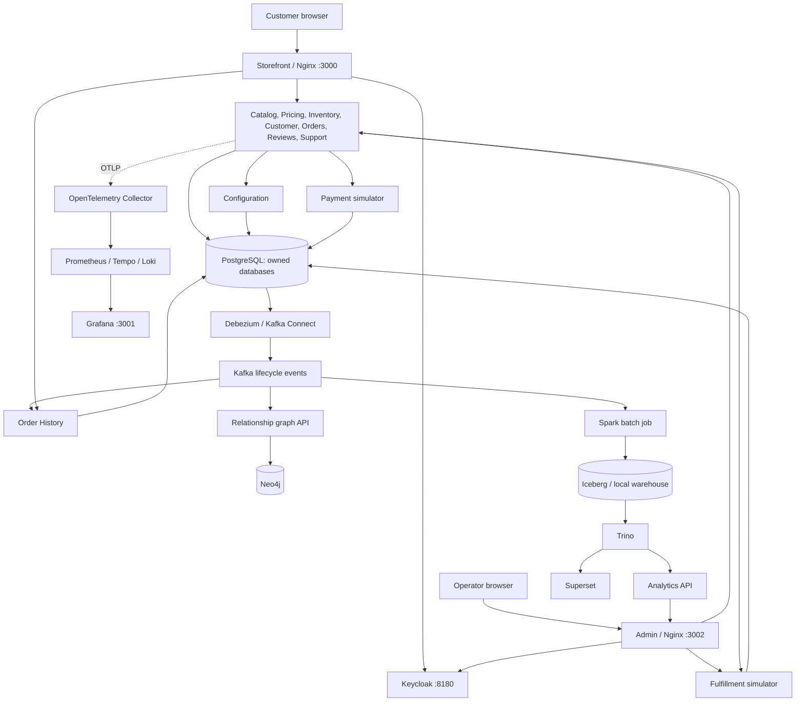
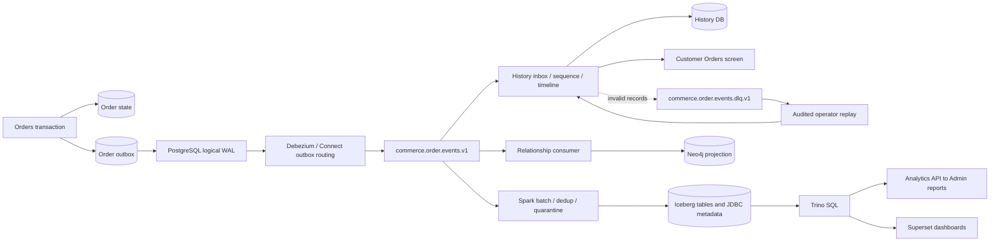
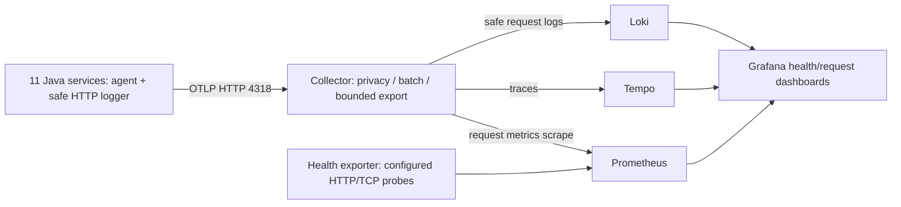

# SuperSports Stage 1 — Knowledge Transfer

This is the starting document for someone taking over development or operating the local learning environment. It describes the implemented Stage 1 system at commit `e8a4868`, including the subsequent banner/image/search corrections. Nova is the future shopping assistant; it is not deployed. All payments, shipping, stock fixtures and demo commerce data are simulated. Product models/photos are sourced, with provenance retained.

The runtime inventory was checked on **26 October 2026**: **34 Compose service definitions, 25 running containers**, six stopped optional application/infrastructure containers, one completed initialization container, and two job/drill definitions without retained containers. Availability is a dated snapshot, not a promise that optional profiles are always running. The [sanitized inventory](supersports-stage1-inventory.json) records exact ports, memory limits, profiles and named volumes without secrets. This guide is a high-level map; linked contracts/source and milestone records contain payloads, detailed rules and failure-injection evidence.

## 1. Architecture in one page

SuperSports has two React/TypeScript applications, served independently by Nginx. Their `/api/...` routes proxy to independently running services. Eleven Java/Spring Boot services own business state in separate PostgreSQL databases on one local PostgreSQL instance. Keycloak handles customer/operator/service identity. Durable Orders state drives a retryable checkout Saga; the same transaction writes lifecycle facts into an outbox. Debezium captures that outbox through PostgreSQL WAL into Kafka. History, graph and batch analytics build separate read models from those events.

Services call other services' APIs; they do not join each other's private database tables. A shared PostgreSQL process is infrastructure sharing, not shared ownership of business tables. Derived History/Neo4j/Iceberg data does not authorize a purchase or change stock/money. Internal service names resolve through Docker DNS, for example `http://catalog:8080`; `localhost:8081` is the host-side publication of that service.



[Editable overview](diagrams/kt-overview.mmd). Telemetry is cross-cutting; the diagram abbreviates its eleven instrumented Java producers rather than listing an edge for each. The optional graph and analytics paths are independent consumers, not dependencies of checkout.

## 2. Human interfaces and credentials

Use `localhost` in browsers because Keycloak callback URLs are configured for it. Published ports bind to host loopback. All operational **human** interfaces below use the requested local demo **admin / admin**. API Bearer tokens, database passwords and service client secrets are separate; `admin/admin` is not a universal database/API credential.

| Interface | Host URL | Credentials / purpose | Observed state |
| --- | --- | --- | --- |
| Storefront | http://localhost:3000 | Register/use a separate customer account; no shared operator password | Running |
| SuperSports Admin | http://localhost:3002/admin | `admin` / `admin`; merchandising, settings, post-purchase operations, reviews/support and reports | Running |
| Keycloak console | http://localhost:8180/admin/master/console/ | `admin` / `admin`; manage master/realms/clients/users | Running |
| Kafka UI / Kafbat | http://localhost:8091 | `admin` / `admin`; read-only inspection of topics/messages/partitions/groups/Connect | Running |
| Grafana | http://localhost:3001 | `admin` / `admin`; health/request dashboards, traces/logs in Explore; Skip an offered first-login password prompt | Running |
| Prometheus | http://localhost:9090 | Browser Basic auth `admin` / `admin`; PromQL via Nginx proxy | Running |
| Neo4j Browser | http://localhost:7474/browser/ | `admin` / `admin`; database `neo4j`, Bolt `bolt://localhost:7687` | Stopped; graph profile |
| Trino UI | http://localhost:8096/ui/ | Browser Basic auth `admin` / `admin`, then upstream username `admin` if prompted | Stopped; analytics profile |
| Superset | http://localhost:8095 | `admin` / `admin`; build SQL datasets/charts/dashboards over Trino | Stopped; dashboards profile |

The historical storefront `/admin` URL redirects to the separate Admin app. These logins are local learning defaults, not production credentials. Provisioning/restart/account details are in the [UI access guide](../setup/ui-access.md).

### Database and machine access

| Connection | Address / identity | Credential source and boundary |
| --- | --- | --- |
| Host PostgreSQL / DBeaver | `127.0.0.1:15432`, database `postgres`, user `postgres` | `POSTGRES_PASSWORD` in ignored `devops/.local/bootstrap.env`. Enable Show all databases. Port is opt-in and currently enabled; [DBeaver guide](../setup/database-access.md). |
| Application PostgreSQL | `postgres:5432`, owned database/user in the service table below | Corresponding `*_DB_PASSWORD` in the same ignored file; application containers receive their own secret. |
| Neo4j service identity | `bolt://neo4j:7687`, user `neo4j` | `GRAPH_DB_PASSWORD`; distinct from the human `admin/admin` account. |
| Kafka broker | Internal `kafka:9092`; published `127.0.0.1:9092` | Local PLAINTEXT demo broker, no broker login configured. It advertises `kafka:9092`, so host clients also need that advertised hostname resolvable/routable. Prefer Kafka UI or container-network tools; a published port alone does not configure a host Kafka client. |
| Kafka Connect REST | http://localhost:8090/connectors | No separate REST login configured; local operational endpoint, not a customer API. |
| Internal business APIs | Service HTTP base plus routes below | Keycloak Bearer JWT, with the route's customer/operator/worker audience rules. Never substitute Basic auth. |
| Host Ollama | Normally http://localhost:11434 | Host-installed prerequisite for future Nova; not a Compose service and not required by commerce. Current running/model state was not probed for this KT task. |

No generated secret values are copied into this tracked document. Read the named entry locally when connecting; do not commit the bootstrap file or a DBeaver connection export. The current History database is a rebuild target, not necessarily the original `order_history`: use `devops/scripts/supersports stream-status` and the persisted target rather than assuming its name. At this checkpoint it is `order_history_r_3ca8f0ec3312`, group `order-history-r-3ca8f0ec3312`.

## 3. Application service catalog and design

All Java rows below are independent Java 27 / Spring Boot 4.1.2 projects, JDBC/Flyway backed, exposing HTTP on container port 8080. Each has a **512 MiB** configured container limit except **Order History 768 MiB**. Every row is running except the two explicitly optional Python APIs. Frontends have **128 MiB** limits. Limits are configuration, not measured consumption.

| Service / source | Responsibility and design | Data ownership | Main touchpoints |
| --- | --- | --- | --- |
| [Storefront](../../apps/storefront) | React 19.3 / TypeScript / Vite build, Nginx static app and API proxy; browse/search, variant cart/wishlist, profile, checkout, history, reviews/support | Browser session/UI state; business state remains server-owned | Customer Keycloak realm; Catalog, Pricing, Inventory, Customer, Orders, History, Reviews, Support |
| [Admin](../../apps/admin) | Separate React/TypeScript app/theme and Nginx proxy; merchandising, configuration, fulfillment, moderation, support, reports | No separate business database | Operator Keycloak realm; owning APIs; Analytics API for optional reports |
| [Catalog](../../services/catalog) | Sports/categories, products and sellable SKUs, photographic details/provenance, activation/revision/retirement. Search is PostgreSQL whole-word/equipment-aware relevance; Similar Products uses metadata/sport ranking | `catalog`, user `supersports_catalog`, `CATALOG_DB_PASSWORD` | Storefront/Admin and Customer/Orders/Inventory callers; Pricing completeness check before activation |
| [Configuration](../../services/configuration) | Categorized adapter/config registry; revisioned checkout/return settings. Some infrastructure adapters are migration/configuration choices, not hot-swappable runtime services | `configuration`, `supersports_configuration`, `CONFIGURATION_DB_PASSWORD` | Admin; Orders settings/policy reads |
| [Pricing](../../services/pricing) | INR/USD price books, active currency, quote calculation, product-eligible coupons and coupon holds/commit/release. Amounts use integer minor units | `pricing`, `supersports_pricing`, `PRICING_DB_PASSWORD` | Storefront/Admin; Catalog completeness; Orders checkout worker |
| [Inventory](../../services/inventory) | Stock balances/movement ledger, revisions/idempotent adjustments, reservation/protection/commit/release, cancellation reversals, inspected-return restock | `inventory`, `supersports_inventory`, `INVENTORY_DB_PASSWORD` | Storefront/Admin; Catalog validates active SKU for adjustments; Orders worker receives/returns stock |
| [Customer](../../services/customer) | Customer-owned Indian address/profile, cart and wishlist; checks SKU facts via Catalog | `customer`, `supersports_customer`, `CUSTOMER_DB_PASSWORD` | Storefront/customer realm; Catalog; Orders reads the owned profile |
| [Orders](../../services/orders) | Checkout idempotency, immutable price/address/settings snapshots, durable fenced Saga and post-purchase state, transactional outbox; authenticated synthetic-order import for fixtures | `orders`, `supersports_orders`, `ORDERS_DB_PASSWORD` | Customer, Catalog, Pricing, Configuration, Inventory, Payment, Fulfillment, Keycloak; Reviews/Support ownership validation; Debezium reads outbox |
| [Payment simulator](../../services/payment-simulator) | Deterministic authorization/capture/void/refund ledger, bounded refund totals, operation-key replay/conflict and fencing; no payment gateway | `payment`, `supersports_payment`, `PAYMENT_DB_PASSWORD` | Orders worker only for payment mutations |
| [Fulfillment simulator](../../services/fulfillment-simulator) | Schedule simulated shipments, operator tracking transitions, delivery facts and cancellation claim/finalization race boundary; no carrier | `fulfillment`, `supersports_fulfillment`, `FULFILLMENT_DB_PASSWORD` | Orders worker/tracking/eligibility; Admin operator transitions |
| [Order History](../../services/order-history) | Kafka-derived customer order timeline/read model; inbox deduplication, aggregate sequencing, gap/DLQ handling, freshness, replay/rebuild support | Current History target database, `supersports_order_history`, `ORDER_HISTORY_DB_PASSWORD` | Kafka; Storefront/customer JWT; local owner/operator reconciliation and rebuild tooling |
| [Reviews](../../services/reviews) | Customer verified-purchase reviews, operator moderation, public summary batches, labelled DEMO review seed/replay; only published reviews affect public summaries | `reviews`, `supersports_reviews`, `REVIEWS_DB_PASSWORD` | Orders verifies owned delivered purchase; Storefront/Admin; Keycloak |
| [Support](../../services/support) | Owned support tickets/messages, operator queue/status transitions/audit | `support`, `supersports_support`, `SUPPORT_DB_PASSWORD` | Orders verifies order ownership when linked; Storefront/Admin; Keycloak |
| [Analytics API](../../services/analytics-api) | Python/FastAPI read-only allowlisted Trino queries; period/currency reports. Readiness route is process readiness; report requests test Trino/tables | No business DB; reads Iceberg projections through Trino | Admin `/api/reports/...`; Trino. **Stopped**, analytics profile, **256 MiB** |
| [Relationship graph](../../services/relationship-graph) | Python/FastAPI Kafka consumer projects `OrderAccepted` into Neo4j: Product–SKU–Order and SKU `BOUGHT_WITH`; bounded one/two-hop relationships | Neo4j projection, not order authority | Kafka, Neo4j, explicit graph API clients. **Stopped**, graph profile, **384 MiB** |
| [Health exporter](../../services/health-exporter) | Small Python HTTP service probes configured HTTP/TCP targets and exposes health metrics | No persistent business data | Readiness targets and Prometheus; **128 MiB**, running observability profile |

**Important:** the relationship graph is not used by storefront search or the current Similar Products rail. It is a separate learning/relationship API and a possible future Nova input. Redis, a vector database, a separate search cluster and a Nova service are not deployed in Stage 1.

### Main API entry points

These are principal operations, not a replacement for the linked OpenAPI contracts. Direct bases below are loopback developer endpoints. All Java services also expose `/actuator/health/readiness` and `/actuator/health/liveness`; frontends expose `/healthz`. A healthy process does not prove all business dependencies/optional reports are available.

For browser APIs, Nginx rewrites `/api/catalog/...` to `/api/v1/catalog/...`, and similarly for pricing/inventory/customer/orders/history/configuration. Reviews/support/fulfillment use a different rewrite: `/api/reviews/...`, `/api/support/...`, `/api/fulfillment/...` become `/api/v1/...`. For example, public reviews are `/api/reviews/reviews/products/{id}` through the frontend. Reports keep `/api/reports/...` unchanged. See [Storefront proxy](../../devops/nginx/storefront.conf) and [Admin proxy](../../devops/nginx/admin.conf).

| Service base on host | Principal routes relative to base | Access / contract |
| --- | --- | --- |
| Catalog http://localhost:8081 | `GET /api/v1/catalog/public/products?q=bat&page=1&pageSize=24`; `GET .../public/products/{slug}` and `/{slug}/similar`; sports/categories; admin product/SKU create/update/activate/retire | Public browse/detail; operator mutations; worker `GET /api/v1/internal/checkout/catalog/skus/{skuId}`. [Contracts](../../contracts/catalog) |
| Configuration http://localhost:8082 | `GET /api/v1/configuration`; `PUT /api/v1/configuration/checkout/{key}` and `/returns/{key}`; `GET /api/v1/internal/checkout/configuration` and `/returns-policy` | Operator configuration; worker settings/policy. [Contracts](../../contracts/configuration) |
| Pricing http://localhost:8083 | `/api/v1/pricing/currency`, `/public/skus`, `/prices`, `/coupons`; internal `POST /api/v1/internal/checkout/pricing/quotes`, `/coupon-holds` and order hold transitions | Public price snapshots, operator management, worker quote/holds. [Contracts](../../contracts/pricing) |
| Inventory http://localhost:8084 | `/api/v1/inventory/availability`, `/balances`, `/movements`, `/adjustments`, `/returns/pending`, `/returns/{returnId}/inspection`; internal `/api/v1/internal/checkout/inventory/reservations` and `/returns/{returnId}/receive` | Public availability; operator adjustment/inspection; worker reservation/restock. [Contract](../../contracts/inventory/openapi.yaml) |
| Customer http://localhost:8085 | `GET/PUT /api/v1/customer/profile`; `GET /cart`, `PUT/DELETE /cart/items/{skuId}`; `GET /wishlist`, `POST/DELETE /wishlist/items/{skuId}` under `/api/v1/customer` | Customer JWT and subject ownership. [Contract](../../contracts/customer/openapi.yaml) |
| Orders http://localhost:8086 | `POST /api/v1/orders/checkout`; `GET /checkout-requests/{requestId}`; order list/detail/tracking; `POST /{orderId}/cancellations`, `POST /{orderId}/returns` and eligibility/status reads under `/api/v1/orders` | Customer JWT; `Idempotency-Key` for checkout/cancel/return. Worker-specific ownership/purchase checks support other services. [Contract](../../contracts/orders/openapi.yaml) |
| Payment http://localhost:8087 | `POST /api/v1/internal/checkout/payments/{operation}` (`authorize`, `capture`, `void`, `refund`); `GET /{orderId}/status` | Internal worker JWT; no human payment UI. [Contract](../../contracts/payment-simulator/openapi.yaml) |
| Fulfillment http://localhost:8088 | `POST /api/v1/internal/checkout/fulfillment`; `GET /{orderId}`, `POST /{orderId}/cancel-claim`, `/cancel-finalize`; `POST /api/v1/operator/shipments/{orderId}/transitions` | Worker schedule/cancel; operator shipment transitions. [Contract](../../contracts/fulfillment-simulator/openapi.yaml) |
| History http://localhost:8089 | `GET /api/v1/order-history`; `GET /api/v1/order-history/{orderId}` | Customer JWT/owner-key projection filtering; freshness metadata. [Contract](../../contracts/order-history/openapi.yaml) |
| Reviews http://localhost:8092 | `GET /api/v1/reviews/products/{productId}`, `/products/summaries`; `GET/POST /api/v1/customer/reviews`; operator `/api/v1/operator/reviews`, `/pending`, `/{id}/moderation`, `/demo-seed` | Public summaries/published reviews; customer submit; operator moderation/seed. [Contract](../../contracts/reviews/openapi.yaml) |
| Support http://localhost:8093 | `/api/v1/customer/support/tickets` and `/api/v1/operator/support/tickets`; detail/messages; operator `PUT /{id}/status` | Customer-owned ticket access or operator token. [Contract](../../contracts/support/openapi.yaml) |
| Graph http://localhost:8094 | `GET /api/relationships/products/{product_id}?depth=1&limit=12`; `/health/ready` | Optional loopback graph API; no auth layer in its current FastAPI handler. Do not mistake this for a public customer endpoint. [Source](../../services/relationship-graph/app.py) |
| Analytics, internal `http://analytics-api:8080` | `GET /api/reports/summary`, `/daily-sales`, `/top-products`, `/refunds` with `currency`, `days` and bounded `limit` where supported | No direct host port; reachable through frontend `/api/reports/...` when enabled. Current API has allowlisted read queries but no JWT enforcement in its Python handler. [Source](../../services/analytics-api/app.py) |
| Health exporter, internal `http://health-exporter:9108` | `GET /metrics`, `/healthz` | Internal monitoring, no human credentials. [Source](../../services/health-exporter/app.py) |

The Admin/frontends do not turn an unauthenticated Python reporting handler into a service-level authorization boundary. Current local exposure/handler limits are explicit rather than assumed enterprise security.

## 4. Identity and configuration boundaries

Keycloak runs as `identity`, backed by database `identity`, user `supersports_identity`, secret `IDENTITY_DB_PASSWORD`. There are three distinct uses: **master** for console administration, **supersports** for operator/service clients, and **supersports-customers** for customer registration/login. The SPAs use browser OIDC; business services validate JWT issuer/audience. The Orders worker obtains a service token using client credentials so it can recover work after the customer's browser closes. Customer ownership remains enforced despite the deliberately simple operator login.

The configuration UI manages supported settings with revisions/audit. It does not create a managed Redis/Kafka/cloud account on demand, migrate databases, or switch every adapter without a deployment. Image/version/ports/resource/profile choices live under `devops/`; generated local secrets/state live under ignored `devops/.local/`. See [configuration contract](../../contracts/configuration/openapi.yaml), [identity decision](../decisions/0003-simple-local-authentication.md), and [ADRs](../decisions).

## 5. Infrastructure and other deployed components

Versions below are the repository's tested pins, not a new claim that they are today's newest releases. Exact immutable digests are in [images.lock.json](../../devops/images.lock.json). Services run on a Docker Compose network with independent containers/restart policies/limits; this local runtime is not Kubernetes pods or a multi-node HA deployment.

| Compose component | What it does / touchpoints | Endpoint / access | Profile, limit, observed state |
| --- | --- | --- | --- |
| `postgres` — PostgreSQL 18.6 | Owned transactional DBs plus Keycloak and Iceberg JDBC metadata; WAL logical replication for Orders CDC | Internal `postgres:5432`; optional host 15432, credentials above | Base, 384 MiB, running |
| `identity` — Keycloak 26.8.1 | Customer/operator/service tokens and console; PostgreSQL identity DB | Internal `identity:8080`, host 8180 | Base, 768 MiB, running |
| `kafka` — Kafka 4.3.1 | Single KRaft broker/controller; durable lifecycle/DLQ/replay and Connect internal topics | Internal `kafka:9092`; host-port caveat above | streaming, 1,024 MiB, running |
| `kafka-connect` — Debezium 3.7.0.Final | PostgreSQL CDC connector, replication slot/publication, outbox routing to lifecycle topic; Connect offsets/config/status in Kafka | Internal `kafka-connect:8083`, host http://localhost:8090 | streaming, 1,024 MiB, running |
| `kafka-ui` — Kafbat 1.5.0 | Inspects broker/topics/records/groups/connector state; read-only cluster configuration is not broker ACL enforcement | Host 8091, admin/admin | streaming, 512 MiB, running |
| `neo4j` — 2026.10.1 Community | Graph storage for relationship service; persistent product/SKU/order/co-purchase nodes/edges | Browser 7474 / Bolt 7687; logins above | graph, 1,536 MiB, stopped |
| `trino` — 484 | SQL engine over Iceberg JDBC catalog/warehouse; consumed by reporting API/Superset | Internal `trino:8080`; no direct host publication | analytics, 1,024 MiB, stopped |
| `trino-ui` — pinned Nginx | Host Basic-auth gate in front of Trino UI/HTTP | Host 8096, admin/admin | analytics, 64 MiB, stopped |
| `superset` — 6.1.0 local image | Optional authoring/report visualization; SQLite metadata under persistent Superset home and Trino data connection | Host 8095, admin/admin | dashboards, 1,536 MiB, stopped |
| `prometheus` — 3.15.1 | Scrapes exporter availability and Collector request metrics; local time-series store | Internal `prometheus:9090`; Grafana datasource | observability, 384 MiB, running |
| `prometheus-ui` — pinned Nginx | Host Basic-auth gate; avoids direct unauthenticated backend publication | Host 9090, admin/admin | observability, 64 MiB, running |
| `grafana` — 13.2.2 | Provisioned health/request dashboards, Prometheus/Tempo/Loki datasources and Explore links; SQLite WAL enabled for local dashboard concurrency | Internal port 3000, host 3001, admin/admin | observability, 512 MiB, running |
| `otel-collector` — 0.163.2 contrib | Receives Java OTLP, sanitizes/batches/routes traces/logs/metrics; allowlists rather than exporting arbitrary payloads | Internal OTLP HTTP 4318; metrics `otel-collector:9464` scrape endpoint; no host ports | observability, 192 MiB, running |
| `tempo` — 3.1.1 | Local trace storage/query backend used by Grafana | Internal HTTP query `tempo:3200`, OTLP ingest; no host ports | observability, 384 MiB, running |
| `loki` — 3.7.9 | Local dedicated safe HTTP-request logs, trace correlation | Internal `loki:3100`, no host ports | observability, 256 MiB, running |

The application table includes the remaining runtime containers: eleven Java services, two SPAs, two optional Python business APIs and the health exporter. The [complete 34-definition inventory](supersports-stage1-inventory.json) is the coverage checklist across both tables and the three execution-only definitions below.

### Jobs, initialization and recovery services

| Definition / project | Function and data touchpoints | Runtime behavior |
| --- | --- | --- |
| `lakehouse-init` | Initializes permissions/directories for the shared local warehouse/Ivy volumes | analytics-job profile; 64 MiB; completed/exited initialization container, no UI/API |
| `spark-ingest` / [lakehouse pipeline](../../data/pipelines/lakehouse) | Spark 4.1.3 batch reads retained Kafka lifecycle facts, validates/quarantines/deduplicates and builds Iceberg reporting tables; PostgreSQL JDBC catalog metadata, `/warehouse` files | analytics-job profile; 1,536 MiB; one-shot run, no retained container/host UI in current snapshot |
| `restore-postgres` | Isolated PostgreSQL restore target for backup/restore drills; separate volume, not a replacement for live PostgreSQL | restore-drill profile; 384 MiB; created for drills, absent now, no host port |
| [Real-catalog pipeline](../../data/pipelines/real-catalog) | Reviewed source manifest/photo restore, import through owning APIs, both price books/stock/DEMO review fixture orchestration; retires superseded active fixtures | Host `.venv/bin/python` tools; no permanent service/API |
| [Demo-commerce pipeline](../../data/pipelines/demo-commerce) | Reproducible synthetic customer/order history via intended fixtures/import boundary | Host tool; not a separate running container |

### Persistence, networking and deployment

| Persistent storage | Contents / owner |
| --- | --- |
| `supersports_postgres-data` | All owned SQL databases and logical WAL; preserve during normal restart |
| `supersports_kafka-data` | Broker topic logs and single-node KRaft state |
| `supersports_graph-data` | Neo4j projection |
| `supersports_lakehouse-data` | Local Iceberg warehouse files, shared by Spark and Trino; catalog metadata is in PostgreSQL `lakehouse` |
| `supersports_analytics-ivy` | Spark dependency cache, not business authority |
| `supersports_superset-home` | Superset local metadata/state |
| `supersports_prometheus-data`, `supersports_grafana-data`, `supersports_tempo-data`, `supersports_loki-data` | Local telemetry/dashboard stores |
| `restore-drill-data` under the drill project/configuration | Disposable isolated restored database, separate from live data |

Frontend photos are locally restored source assets packaged into the Storefront image; they are not hosted cloud storage. The reviewed manifest/provenance is tracked, while restored binaries/local state are ignored and reproducible. Backups and generated credentials belong to local ignored storage, not Git. Migrations are Flyway-owned; application rollback does not automatically reverse schemas/data.

The baseline host is a 16 GB ARM64 Mac with roughly 7.75 GiB allocated to Docker in the release measurement. The 25-container final snapshot used 6,453.52 MiB; a separate 24-container/120-second functional observation peaked at 6,369.28 MiB. These are finite observations, not capacity promises. Run Spark, graph, Trino and Superset selectively; enabling every profile together is not the default baseline workload. Alternate Kubernetes/Helm/Terraform artifacts are maintained under [devops](../../devops), but no Kubernetes cluster/cloud deployment is claimed.

## 6. Overall business and data flows

### A. Sign in, browse and manage products

A customer registers/signs in through the customer realm; anonymous browsing remains possible. Storefront requests paginated Catalog models plus batched Pricing/Inventory/Reviews snapshots. Product selection resolves a specific SKU; Customer owns the saved cart/wishlist/address. Search uses equipment metadata and whole words in PostgreSQL. Explicit sort controls can reorder the current page; they do not turn the system into semantic/graph search.

An operator uses the separate Admin/operator identity to create/edit models/SKUs and source details, set owning Pricing/Inventory records, then activate the model after required completeness/validity checks. Revision/idempotency conflicts prevent silent overwrites. Retiring a listing hides it from current shopping while preserving historical identity/order snapshots.

### B. Checkout and recovery

```mermaid
sequenceDiagram
  actor Customer
  participant UI as Storefront
  participant O as Orders
  participant Facts as Customer / Catalog / Pricing / Configuration
  participant I as Inventory
  participant P as Pricing coupon holds
  participant Pay as Payment simulator
  participant F as Fulfillment simulator
  Customer->>UI: Confirm exact SKU quantities and checkout
  UI->>O: POST checkout + customer JWT + Idempotency-Key
  O->>Facts: Validate owned address, active SKUs, quote, settings
  O->>O: Persist accepted order, snapshots, Saga and outbox
  O-->>UI: Request/order identity; poll durable status
  O->>I: Reserve stock
  O->>P: Hold coupon eligibility/limit
  O->>Pay: Authorize simulated payment
  O->>I: Protect stock hold
  O->>P: Protect applicable coupon hold
  O->>Pay: Capture payment
  O->>I: Commit reservation
  O->>P: Commit applicable coupon hold
  O->>O: Confirm order + outbox fact
  O->>F: Schedule shipment
  O->>O: Fulfillment scheduled + outbox fact
  UI->>O: Read order/tracking
```

[Editable checkout sequence](diagrams/kt-checkout.mmd). The durable worker performs these operations, not the browser. Each service commits only its own state. Idempotency keys, persisted operation results and fencing make retries controlled; this is a Saga with compensation/reconciliation, not one cross-database transaction. A decline releases holds; outages leave retryable work, while ambiguous/unsafe states can require explicit review. Historical quote/currency/address values are snapshots, so later Catalog/price/address edits do not rewrite an old order. See [Saga source](../../services/orders/src/main/java/com/supersports/orders/CheckoutSagaWorker.java) and [checkout design](../milestones/S1-M05).

### C. Tracking, cancellation, returns, reviews and support

Fulfillment owns shipment transitions/delivery facts; Orders exposes customer-owned tracking. Before handoff, a cancellation first claims the shipment boundary, then completes simulated refund, inventory reversal and shipment finalization through retryable idempotent steps. This avoids refunding and shipping the same order in a handoff race.

For a return, Orders verifies ownership, delivery/window and quantities, reserves immutable original-value refund allocations and completes bounded Payment work. Stock does **not** become sellable merely because a refund was issued: operator receipt/inspection in Inventory determines restock, including rejected/damaged outcomes. Published lifecycle facts feed the same projections.

Reviews checks the customer's delivered purchase with Orders, stores a pending review, then operator moderation controls publication/aggregate counts. Sourced demo fixtures remain visibly DEMO, never verified purchases. Support owns tickets/messages and checks linked-order ownership with Orders. See [post-purchase design/evidence](../milestones/S1-M07), [reviews contract](../../contracts/reviews/openapi.yaml) and [support contract](../../contracts/support/openapi.yaml).

### D. CDC, customer history, graph and analytics



[Editable data flow](diagrams/kt-data-flow.mmd). Lifecycle schemas are versioned; the topic name retaining `v1` does not mean every payload has eventVersion 1. [V1/V2 contracts](../../contracts/orders) and shared parsers define compatibility. Consumer groups/offsets are independent.

History deduplicates event IDs, applies aggregate sequence rules and exposes freshness. The Storefront can fall back to owned Orders records when the projection is delayed/blocked/unavailable. Poison records use transactional DLQ/audited replay; rebuilding creates a candidate DB/group, reconciles retained source/Kafka/projected facts, then switches the persisted target. This is why an operator should discover the current History DB rather than hardcode it.

Graph handles accepted-order co-purchase relationships only; it is not a current-inventory or net-sales view. Spark is an explicitly invoked batch job, not a claim of continuously up-to-date dashboards. Reports expose currency-specific order value/GMV, counts, units, discounts/refunds, trend/product/refund breakdowns with defined time windows. Mixed-currency sums and all-state order totals are not sales. [Metric definitions](../milestones/S1-M08/dashboard-and-metrics.md) explain inclusion/time/refund limits; Admin derives display metrics from the reports. Superset is a separate optional authoring interface, not the only dashboard path.

### E. Observability



[Editable telemetry flow](diagrams/kt-telemetry.mmd). The Java agent is packaged in app images but SDK-disabled by default; the explicit telemetry lifecycle enables the running Java services while preserving actual image identities/History target. Prometheus health-only observability and request telemetry are related but separate switches.

Grafana dashboards show readiness and request rate/error/p95/mean response time; Explore joins traces/logs. Exported logs are the dedicated safe HTTP-request stream, not every application exception/stdout line. Privacy excludes credentials, bodies/query values, personal order/address fields and raw SQL values, with runtime sentinel evidence. Bounded queues may drop telemetry during outages; trace/log retention is configured at 24 hours, not a measured 24-hour endurance/disk quota. Python/frontend instrumentation is outside current request tracing. See [telemetry setup](../setup/request-telemetry.md) and [acceptance](../milestones/S1-M12/verification.md).

## 7. Operator handover: commands and first checks

Run from the repository root, with Docker Desktop available. Host Python must use `.venv/bin/python`; `devops/scripts/supersports` uses the repository environment. Start/select profiles sequentially on the baseline host. These commands are a runbook, not actions performed by reading this document.

| Goal | Command / next check |
| --- | --- |
| Runtime status | `devops/scripts/supersports status` and `devops/scripts/supersports doctor` |
| Validate deployment definitions | `devops/scripts/supersports validate` |
| Streaming and connector status | `devops/scripts/supersports stream-status`; inspect Kafka UI topics/consumer lag/Connect task |
| Start streaming if absent | `devops/scripts/supersports streaming-up` |
| Local health dashboards | `devops/scripts/supersports observability-up` |
| Enable/disable request telemetry | `devops/scripts/supersports telemetry-up` / `telemetry-down`; preserve images/target and recheck readiness |
| Reports/query engine | `devops/scripts/supersports analytics-up`, then `analytics-run` for batch freshness |
| Graph projection | `devops/scripts/supersports graph-up`; open Neo4j / bounded graph API |
| Superset authoring | `devops/scripts/supersports dashboard-studio-up`; follow analytics prerequisite |
| Reconcile retained History | `devops/scripts/supersports stream-reconcile`; require JSON `ok=true` and `errorCount=0`, not just a page rendering |
| DB host access | `.venv/bin/python devops/scripts/database_access.py status` / `verify`; DBeaver guide above |
| Repair/verify human UI accounts | `.venv/bin/python devops/scripts/ui_access.py`; only enabled/running supported profiles are checked |
| Backup / isolated recovery | `devops/scripts/supersports backup` / `restore-drill`; [operations guide](../../devops/README.md) describes scope and outputs |

Do not use `reset`, delete volumes, rerun obsolete generated-art catalog fixtures, or restore over live commerce as a routine restart. Release/rollback workflows distinguish application images from database migration/data recovery. Do not paste raw Docker environment/config or bootstrap secrets into Git/issues.

| Symptom | First boundary to inspect |
| --- | --- |
| Cannot sign in | Correct origin/realm; Keycloak readiness; callback/client configuration; customer vs operator account |
| Wrong search results | Catalog equipment metadata/title and whole-word query; actual `/public/products?q=...`; current image checkpoint |
| Price/stock missing | Pricing/Inventory readiness and batch snapshot responses, active SKU/currency; a Catalog card alone does not prove checkout availability |
| Checkout stays pending | Owned request/order state and persisted Saga step; dependency/worker token readiness; do not blindly resubmit with unrelated operation keys |
| Order History lags | Orders authority vs History freshness/sequence gap; Connect task/slot, Kafka partitions/groups, DLQ; use fallback/reconciliation |
| Reports return 503 or look stale | Optional analytics profile, Trino/Iceberg tables and most recent explicit Spark batch, currency/time-window definitions |
| Graph unavailable | Graph/Neo4j profiles, Neo4j service credentials and consumer progress; storefront search does not depend on it |
| No trace/log | Actual Java SDK enablement, Collector/store readiness, Grafana datasource and selected time range; logging scope is intentionally limited |

## 8. Data, evidence and where to work next

The release baseline has **103 Cricket /113 Football products**, **1,030/1,130 SKUs**, INR/USD books and **751 published DEMO reviews**. Product is the model; SKU is a sellable size/colour option. The historical synthetic workload includes 1,000 profiles and prior-year orders; verification creates additional fixtures, so do not assume the original seeded order count is today's total. The final retained reconciliation recorded 36,537 events/18,077 orders with zero errors; that is a checkpoint, not an immutable business metric. Subsequent user-requested catalog expansion will change counts; consult [current status](../context/status.md).

| Work area | Canonical location |
| --- | --- |
| Service implementation/unit tests/migrations | `services/<service>/`; Java public contracts under `contracts/` |
| Browser apps and Selenium | `apps/storefront`, `apps/admin` and their tests |
| Data manifests/import/batch transformations | `data/pipelines/`; photos/provenance instructions in real-catalog README |
| Docker/Compose/CI/ops/Kubernetes/Helm/Terraform | `devops/`; do not scatter infrastructure into service directories |
| Reviewed designs/ADRs | [Design index](../../design/README.md), [milestones](../milestones/README.md), [decisions](../decisions) |
| Current context/decisions and release limits | [Project context](../context/project-context.md), [accepted requirements](../../requirements/accepted-requirements.md), [Stage 1 acceptance](../context/stage1-completion.md) |
| Manual handover checks | [Stage 1 owner checks](../testing/stage1-release-checks.md), linking each milestone's service/UI/feature/database checklist |

The KT task inspected code/configuration and sanitized runtime inventory; it did not rerun the full commerce test suite, restart services, or perform the owner's manual sign-off. Existing release evidence records unit/real-DB/contract/integration/Selenium/recovery/resource results, explicit skips and cold-start limits. Independent review tooling was unavailable for the recorded release; passing runtime checks are not presented as a clean independent review. This handover adds no cloud service, changes no credentials/data, and does not implement Nova. Next-stage implementation requires its own reviewed design and a published stage branch.
